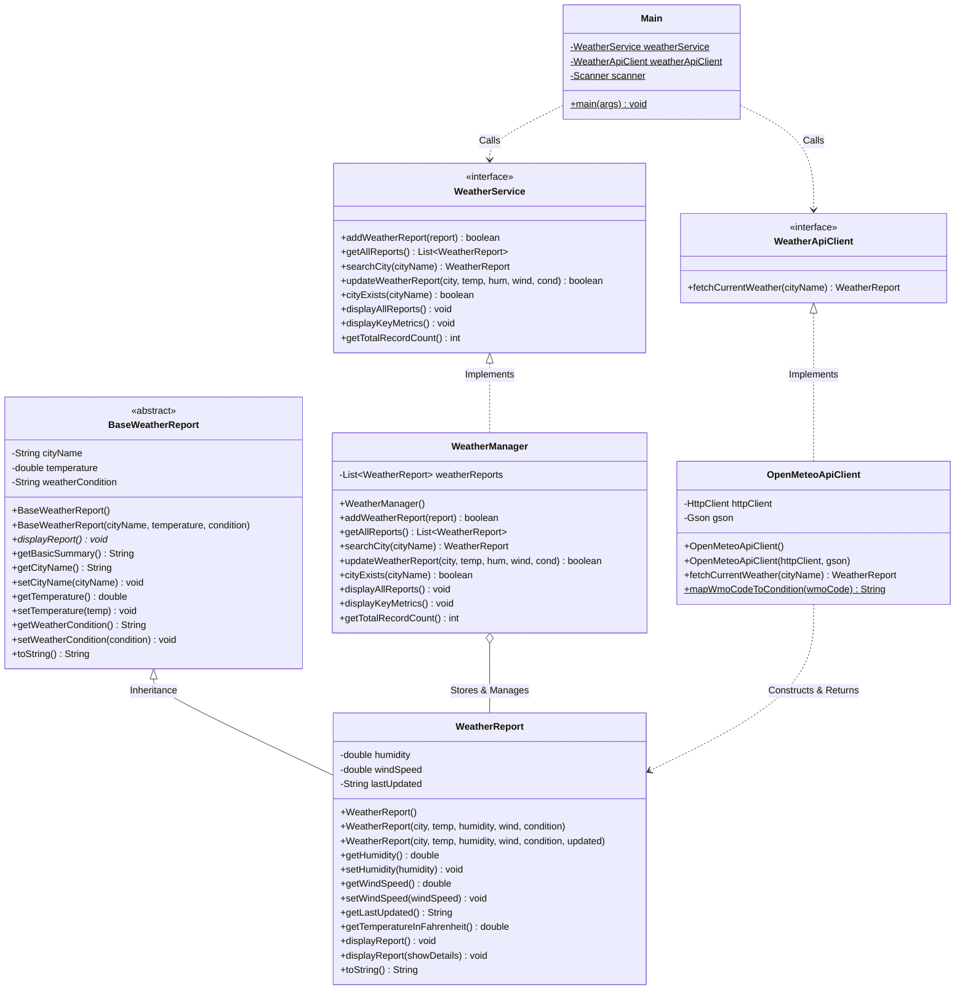

# Weather Report System

A modular, robust, and object-oriented Java console application designed for academic coursework and engineering demonstrations. The **Weather Report System** allows users to record, search, update, compare, and display meteorological data across various cities. In addition to manual data entry, the system integrates with the **Open-Meteo REST API** to retrieve live atmospheric conditions worldwide using Java's built-in `HttpClient` and Google `Gson` without requiring an API key.

---

## Table of Contents
1. [Project Overview](#project-overview)
2. [Key Features & Menu Structure](#key-features--menu-structure)
3. [Technologies & Dependencies](#technologies--dependencies)
4. [Object-Oriented Programming (OOP) Concepts](#object-oriented-programming-oop-concepts)
5. [System Architecture](#system-architecture)
6. [Project Structure](#project-structure)
7. [How the Application Works](#how-the-application-works)
8. [Open-Meteo API Integration Details](#open-meteo-api-integration-details)
9. [Installation & Execution Guide](#installation--execution-guide)
10. [Known Limitations & Future Improvements](#known-limitations--future-improvements)
11. [License](#license)

---

## 1. Project Overview

Tracking and comparing weather across multiple cities typically requires either manual logging or querying online meteorological services. The **Weather Report System** bridges both worlds in an educational, console-based Java application.

### Purpose & Problem Addressed
- **Educational Demonstration**: Serves as a concrete implementation of core Object-Oriented Programming principles (Encapsulation, Abstraction, Inheritance, Polymorphism, and Interface-driven design) in standard Java.
- **Hybrid Data Ingestion**: Supports both offline manual logging and real-time online weather data retrieval.
- **Data Integrity**: Enforces physical boundary validation (e.g., realistic Earth surface temperatures, non-negative wind speeds, valid humidity limits) and prevents duplicate city records.
- **Fail-Safe Operation**: Provides an automated fallback from live network queries to manual entry if an internet disruption, request timeout, or invalid city name occurs.

---

## 2. Key Features & Menu Structure

### The Seven Console Menu Options
The application presents an interactive 7-option console menu:

1. **Add Weather Information Manually**: Prompts for city name, temperature in Celsius, relative humidity percentage, wind speed in km/h, and weather conditions. Disallows duplicate city entries (case-insensitive).
2. **Fetch Live Weather from Open-Meteo API**: Queries Open-Meteo's Geocoding and Forecast REST APIs via synchronous `HttpClient`, parses the JSON payload with Gson, and constructs a domain `WeatherReport` object.
3. **Display All Weather Reports**: Renders formatted report cards for every stored city, showing both Celsius and Fahrenheit temperatures, humidity, wind speed, condition, and timestamp.
4. **Search Weather by City**: Performs case-insensitive matching (`"kolkata"`, `"KOLKATA"`, and `"Kolkata"` match identically) and displays the matching record.
5. **Update Weather Information**: Updates temperature, humidity, wind speed, and weather condition for an existing city while preserving the city name and refreshing the timestamp.
6. **Display Temperature, Humidity and Wind Speed**: Formats a structured comparison table presenting these three primary metrics across all stored cities.
7. **Exit**: Closes the application scanner and terminates the program cleanly.

### Additional System Capabilities & Safeguards
- **Manual Fallback on API Failure**: When an API query fails (due to network timeout, offline status, or non-existent city), the system prompts the user with an option to manually enter weather metrics for that city without retyping the city name.
- **Strict Input Validation & Custom Exceptions**: Catches non-numeric inputs, out-of-range physical measurements, and network failures gracefully without terminating the program.

---

## 3. Technologies & Dependencies

| Technology / Library | Version / Requirement | Role & Description |
| :--- | :--- | :--- |
| **Java Development Kit (JDK)** | **Java 11+** (Verified on JDK 27) | Standard Java runtime and compiler. Java 11 or higher is required for the native `java.net.http.HttpClient` API. |
| **Java `HttpClient`** | Standard Library (`java.net.http.*`) | High-level HTTP client executing **synchronous (blocking)** HTTP GET requests via `httpClient.send()` with custom timeouts and HTTP status code validation. |
| **Google Gson** | **2.10.1** (`lib/gson-2.10.1.jar`) | Lightweight Java JSON parser used to deserialize Open-Meteo API JSON responses into Java Data Transfer Objects (DTOs). |
| **Open-Meteo Geocoding API** | REST (`/v1/search`) | REST endpoint converting human-readable city names into geographic coordinates (latitude and longitude). Does not require an API key for non-commercial educational use. |
| **Open-Meteo Forecast API** | REST (`/v1/forecast`) | REST endpoint providing current temperature, relative humidity, wind speed, and WMO weather codes. Does not require an API key for non-commercial educational use. |
| **IntelliJ IDEA** | Compatible with Community / Ultimate | Primary development environment configured via standard `.iml` module metadata. |

*Note: No build automation tools (Maven or Gradle), external database servers, or heavy GUI frameworks are used. The project compiles with standard JDK tools.*

---

## 4. Object-Oriented Programming (OOP) Concepts

The codebase is structured to clearly illustrate fundamental OOP concepts for academic evaluation:

### 1. Classes and Objects
- **Where:** Across all source files (`WeatherReport.java`, `WeatherManager.java`, `OpenMeteoApiClient.java`).
- **Explanation:** `WeatherReport` acts as a blueprint defining state and behavior for weather records. Instances (objects) are dynamically allocated in memory when users add records or when live API data is parsed.

### 2. Encapsulation
- **Where:** `BaseWeatherReport.java` (lines 12–14), `WeatherReport.java` (lines 17–19), `WeatherManager.java` (line 18).
- **Explanation:** All domain fields (`cityName`, `temperature`, `humidity`, `windSpeed`, `weatherReports`) are declared `private`. Access and modifications are restricted to public getters and setters. Setters enforce validation rules (e.g., temperature must be between $-90.0^\circ\text{C}$ and $65.0^\circ\text{C}$).
- **List Encapsulation Note:** In `WeatherManager.getAllReports()`, the list is wrapped using `Collections.unmodifiableList(weatherReports)`. This prevents structural modifications (such as calling `.add()`, `.remove()`, or `.clear()`) through the returned reference. However, it is an unmodifiable wrapper view, not a deep immutable copy; the individual `WeatherReport` objects inside the list remain mutable through their own setter methods.

### 3. Inheritance
- **Where:** `WeatherReport extends BaseWeatherReport` (`WeatherReport.java`, line 15), `InvalidWeatherDataException extends Exception`, `WeatherApiException extends Exception`.
- **Explanation:** `BaseWeatherReport` defines common attributes (`cityName`, `temperature`, `weatherCondition`). `WeatherReport` inherits these properties while extending functionality with `humidity`, `windSpeed`, and `lastUpdated`. Subclass constructors call `super(cityName, temperature, weatherCondition)` to delegate initialization to the parent class.

### 4. Abstraction
- **Where:** `BaseWeatherReport.java` (abstract class), `WeatherService.java` (interface), `WeatherApiClient.java` (interface).
- **Explanation:** `BaseWeatherReport` declares the abstract method `public abstract void displayReport()`, requiring derived classes to define their specific display format. `WeatherService` and `WeatherApiClient` establish service contracts, hiding internal implementation details (such as `ArrayList` traversal or HTTP socket handling) from `Main.java`.

### 5. Polymorphism (Runtime & Compile-Time)
- **Runtime Polymorphism (Method Overriding):** 
  - `WeatherReport.java` (line 96) overrides `displayReport()` defined in `BaseWeatherReport.java` (line 32).
  - `WeatherManager.java` overrides methods defined in `WeatherService.java`.
  - `OpenMeteoApiClient.java` overrides `fetchCurrentWeather()` declared in `WeatherApiClient.java`.
  - `BaseWeatherReport.java` (lines 77–80) overrides `toString()` from `java.lang.Object`.
  - `WeatherReport.java` (lines 114–120) overrides `toString()` from `BaseWeatherReport` / `java.lang.Object`.
- **Compile-Time Polymorphism (Method Overloading):**
  - Overloaded constructors in `WeatherReport.java` (default constructor, 5-parameter constructor, and 6-parameter constructor with timestamp).
  - Overloaded `displayReport()` (line 96) and `displayReport(boolean showDetails)` (line 101) in `WeatherReport.java`.

### 6. Interfaces
- **Where:** `WeatherService.java` and `WeatherApiClient.java`.
- **Explanation:** Interfaces decouple components. In `Main.java`, variables are declared using interface types:
  ```java
  private static final WeatherService weatherService = new WeatherManager();
  private static final WeatherApiClient weatherApiClient = new OpenMeteoApiClient();
  ```
  The application uses interface-based programming to reduce coupling between the presentation layer and concrete service implementations. This supports the principles of dependency inversion, although the concrete implementations are currently instantiated inside `Main`.

---

## 5. System Architecture

The application adopts a modular 3-tier structure: Presentation, Service/API, and Domain/Data.

### Class Responsibilities
- **`BaseWeatherReport` (Abstract Domain Model)**: Defines foundational weather attributes, physical validation logic, and the abstract display contract. Overrides `toString()`.
- **`WeatherReport` (Concrete Domain Model)**: Extends `BaseWeatherReport` with humidity, wind speed, timestamping, temperature conversion, overloaded/overridden `displayReport()`, and an overridden `toString()`.
- **`WeatherService` (Service Interface)**: Declares operations for adding, retrieving, searching, updating, and displaying weather records.
- **`WeatherManager` (In-Memory Service Implementation)**: Implements `WeatherService` using an encapsulated `ArrayList<WeatherReport>`, managing duplicate checks and list queries.
- **`WeatherApiClient` (Remote Service Interface)**: Declares the contract for external weather API data retrieval.
- **`OpenMeteoApiClient` (API Client Implementation)**: Implements `WeatherApiClient`, handling synchronous HTTP requests, URL encoding, geocoding resolution, forecast fetching, WMO code mapping, and Gson parsing.
- **`InvalidWeatherDataException` (Domain Checked Exception)**: Thrown when meteorological data violates physical domain constraints.
- **`WeatherApiException` (Infrastructure Checked Exception)**: Thrown when network communication, HTTP responses, or geocoding resolution fail.
- **`Main` (Presentation Controller)**: Renders the 7-option console menu, processes user input, dispatches commands, handles manual fallback, and coordinates the service and API client.
- **`TestOpenMeteoClient` (Standalone Test Runner)**: A standalone console test runner (with a `main` method) that validates API communication, WMO code mapping, invalid city handling, and data conversion without loading the menu.

### Architecture & Class Relationship Diagram



---

## 6. Project Structure

```text
WeatherReportSystem/
├── lib/
│   └── gson-2.10.1.jar                  # Google Gson JSON library
├── src/
│   └── com/
│       └── weather/
│           ├── BaseWeatherReport.java            # Abstract base domain model
│           ├── InvalidWeatherDataException.java  # Domain validation checked exception
│           ├── Main.java                         # Console menu & user interface
│           ├── OpenMeteoApiClient.java           # Open-Meteo REST API implementation
│           ├── TestOpenMeteoClient.java          # Standalone test runner for API client
│           ├── WeatherApiClient.java             # Remote API interface
│           ├── WeatherApiException.java          # API/Network checked exception
│           ├── WeatherManager.java               # In-memory service implementation
│           ├── WeatherReport.java                # Concrete domain model (subclass)
│           └── WeatherService.java               # Storage service interface
├── .gitignore                           # Git ignore rules (bin, out, idea)
├── README.md                            # Main project documentation
├── VIVA_GUIDE.md                        # Academic study guide & Viva questions
└── WeatherReportSystem.iml              # IntelliJ IDEA module descriptor
```

---

## 7. How the Application Works

### Main Application Loop
1. **Startup**: The application launches from `Main.main(String[] args)` and initializes the console scanner, `WeatherManager`, and `OpenMeteoApiClient`.
2. **Menu Rendering**: Displays options 1 through 7 and prompts for user input.
3. **Command Processing**: Sanitizes input using `readIntegerInput(prompt, 1, 7)` to prevent crashes from non-numeric or out-of-range choices.
4. **Execution**: Dispatches to the corresponding handler (`handleAddWeather`, `handleFetchLiveWeather`, `handleDisplayAllReports`, `handleSearchCity`, `handleUpdateWeather`, `handleDisplayKeyMetrics`).
5. **Pause & Return**: Executes `promptEnterKey()`, allowing the user to review results before the menu displays again.
6. **Clean Termination**: Option 7 sets `running = false`, closes the scanner, and exits gracefully.

### Live API Workflow (Open-Meteo Integration)
```
User Enters City Name (e.g., "Kolkata")
   │
   ▼
Check if City Already Exists locally via weatherService.cityExists()
   │  ├── [Already Exists] ──► Show message and prompt to use Option 5 (Update)
   │
   ▼ [Does Not Exist]
Send Synchronous HTTP GET to Open-Meteo Geocoding API:
   https://geocoding-api.open-meteo.com/v1/search?name=Kolkata&count=5&language=en&format=json
   │
   ▼
Parse Geocoding JSON with Gson:
   Resolves: latitude (22.5626), longitude (88.3630), official name ("Kolkata")
   │
   ▼
Send Synchronous HTTP GET to Open-Meteo Forecast API:
   https://api.open-meteo.com/v1/forecast?latitude=22.5626&longitude=88.3630&current=temperature_2m,relative_humidity_2m,wind_speed_10m,weather_code&wind_speed_unit=kmh
   │
   ▼
Parse Forecast JSON with Gson:
   Extracts: temperature_2m, relative_humidity_2m, wind_speed_10m, weather_code
   │
   ▼
Translate WMO Code via mapWmoCodeToCondition(code) (e.g., 61 -> "Slight Rain")
   │
   ▼
Instantiate new WeatherReport(cityName, temperature, humidity, windSpeed, condition)
   │  └── Enforces physical domain validations inside constructor
   │
   ▼
Display Retrieved Weather Report Card to Console
   │
   ▼
Save Report to In-Memory Collection via weatherService.addWeatherReport(report)
```

---

## 8. Open-Meteo API Integration Details

### API Selection & Authentication
- **No API Key Required**: Open-Meteo provides free access for non-commercial educational use without requiring an API key (subject to their standard fair-use rate limits). This implementation does not require any API keys or credentials, eliminating authentication setup and expired tokens during grading.
- **Separate Geocoding & Forecast Endpoints**: Enables clean separation between location resolution and atmospheric data retrieval.

### API Endpoints Used
1. **Geocoding API**:  
   `https://geocoding-api.open-meteo.com/v1/search?name={city}&count=5&language=en&format=json`  
   Translates city names into geographic coordinates. Candidate matching prioritizes exact case-insensitive matches before falling back to top population-ranked candidates.
2. **Forecast API**:  
   `https://api.open-meteo.com/v1/forecast?latitude={lat}&longitude={lon}&current=temperature_2m,relative_humidity_2m,wind_speed_10m,weather_code&wind_speed_unit=kmh`  
   Retrieves current meteorological values. Explicitly uses `wind_speed_unit=kmh` to match the project's internal data model.

### URL Encoding Details
- City names are encoded using `URLEncoder.encode(cityName, StandardCharsets.UTF_8)`.
- `URLEncoder` follows the `application/x-www-form-urlencoded` standard, encoding spaces as `+` (plus signs). In HTTP query parameters, servers parse `+` as a space character.

### WMO Weather Interpretation Codes
Open-Meteo reports weather conditions using specific assigned integer values defined in WMO Code Table 4677 (not every integer between 0 and 99 is valid). `OpenMeteoApiClient.mapWmoCodeToCondition(int code)` translates these specific codes:
- `0`: Clear sky
- `1`, `2`, `3`: Mainly clear, partly cloudy, overcast
- `45`, `48`: Fog, Depositing rime fog
- `51`, `53`, `55`: Light, Moderate, Dense Drizzle
- `56`, `57`: Freezing Drizzle
- `61`, `63`, `65`: Slight, Moderate, Heavy Rain
- `66`, `67`: Freezing Rain
- `71`, `73`, `75`: Slight, Moderate, Heavy Snow fall
- `77`: Snow grains
- `80`, `81`, `82`: Slight, Moderate, Violent Rain showers
- `85`, `86`: Slight, Heavy Snow showers
- `95`, `96`, `99`: Thunderstorm, Thunderstorm with hail
- Fallback: `Atmospheric Condition (WMO Code X)` for unmapped values.

### Error Handling, Network Exceptions & Timeouts
- **Timeouts**: Configured with a `10-second` connection timeout and `10-second` request timeout.
- **Distinction of Network Exceptions**:
  - `java.io.IOException`: Broad checked exception indicating low-level I/O or network connection failures (e.g. offline status, DNS lookup failure, connection reset).
  - `java.net.http.HttpTimeoutException`: A specific subclass of `IOException` thrown by `HttpClient` when a connection or request timeout expires before completion.
  - `java.lang.InterruptedException`: Thrown when the thread executing `httpClient.send()` is interrupted while blocking. The client catches it, restores the thread interrupt flag using `Thread.currentThread().interrupt()`, and wraps it in `WeatherApiException`.
- **HTTP Status Check**: Verifies `statusCode == 200`. Non-200 responses throw a descriptive `WeatherApiException`.

### Official Documentation Links
- Open-Meteo Weather Forecast API: [https://open-meteo.com/en/docs](https://open-meteo.com/en/docs)
- Open-Meteo Geocoding API: [https://open-meteo.com/en/docs/geocoding-api](https://open-meteo.com/en/docs/geocoding-api)

---

## 9. Installation & Execution Guide

### Option 1: Running in IntelliJ IDEA

1. **Clone the Repository**:
   ```bash
   git clone https://github.com/rtxreo3060/WeatherReportSystem.git
   ```
2. **Open in IntelliJ IDEA**:
   - Launch IntelliJ IDEA.
   - Select **Open** and choose the `WeatherReportSystem` folder.
3. **Verify Project SDK**:
   - Go to **File > Project Structure > Project**.
   - Ensure the SDK is set to **JDK 11 or higher** (JDK 17, 21, or 27 recommended).
4. **Verify Library Dependency**:
   - The `.iml` file automatically links `lib/gson-2.10.1.jar`.
   - Verify in **File > Project Structure > Modules > Dependencies** that `gson-2.10.1.jar` is listed.
5. **Run the Application**:
   - In the Project view, navigate to `src/com/weather/Main.java`.
   - Right-click `Main.java` and select **Run 'Main.main()'**.

---

### Option 2: Running via Windows PowerShell (Command Line)

1. Clone the repository and navigate to the project directory:
   ```powershell
   git clone https://github.com/rtxreo3060/WeatherReportSystem.git
   cd WeatherReportSystem
   ```
2. Create the output directory (if it does not exist):
   ```powershell
   New-Item -ItemType Directory -Force -Path out/production/WeatherReportSystem
   ```
3. Compile all source files with Gson on the classpath:
   ```powershell
   javac -cp "lib/gson-2.10.1.jar" -d out/production/WeatherReportSystem src/com/weather/*.java
   ```
4. Run the interactive console application:
   ```powershell
   java -cp "out/production/WeatherReportSystem;lib/gson-2.10.1.jar" com.weather.Main
   ```
5. Run the standalone API test runner:
   ```powershell
   java -cp "out/production/WeatherReportSystem;lib/gson-2.10.1.jar" com.weather.TestOpenMeteoClient
   ```

---

## 10. Known Limitations & Future Improvements

### Current Limitations
- **In-Memory Volatile Storage**: Weather reports are kept in a Java `ArrayList` in RAM. All stored data is lost when the program terminates.
- **Internet Requirement for Option 2**: Fetching real-time weather requires an active internet connection to contact Open-Meteo.
- **Single-Period Weather**: Only current weather is fetched; historical data and multi-day forecasts are not currently stored.
- **Console Interface**: The application uses a text-based terminal interface without a Graphical User Interface (GUI).

### Planned Future Improvements
- **Persistent Storage**: Implement file-based persistence (JSON/CSV) or an embedded database (SQLite/H2) to retain records across sessions.
- **Multi-Day Forecasting**: Extend `OpenMeteoApiClient` to fetch 7-day weather forecasts and temperature trends.
- **Exporting Capabilities**: Allow users to export generated weather reports and comparison tables to PDF or CSV files.
- **Graphical User Interface (GUI)**: Build a lightweight JavaFX or Swing desktop frontend.

---

## 11. License

This repository currently has **no declared open-source license**. All rights are reserved by the original project author. It is intended for academic evaluation, coursework demonstration, and personal study.
