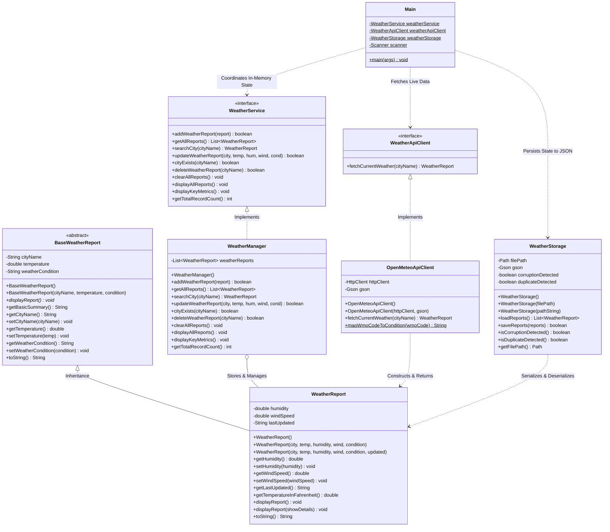

# Weather Report System

A modular, robust, and object-oriented Java console application designed for academic coursework and engineering demonstrations. The **Weather Report System** allows users to record, search, update, compare, delete, and persist meteorological data across various cities. In addition to manual data entry, the system integrates with the **Open-Meteo REST API** to retrieve live atmospheric conditions worldwide using Java's built-in `HttpClient` and Google `Gson` without requiring an API key. Data is reliably persisted across restarts in a human-readable JSON file (`data/weather-reports.json`) equipped with atomic writes, anti-corruption protection, and transactional write-ahead safeguards.

---

## Table of Contents
1. [Project Overview](#1-project-overview)
2. [Key Features & Menu Structure](#2-key-features--menu-structure)
3. [Technologies & Dependencies](#3-technologies--dependencies)
4. [Object-Oriented Programming (OOP) Concepts](#4-object-oriented-programming-oop-concepts)
5. [System Architecture](#5-system-architecture)
6. [Project Structure](#6-project-structure)
7. [How the Application Works](#7-how-the-application-works)
8. [Open-Meteo API Integration Details](#8-open-meteo-api-integration-details)
9. [JSON Persistence & Data Integrity Safeguards](#9-json-persistence--data-integrity-safeguards)
10. [Installation & Execution Guide](#10-installation--execution-guide)
11. [Known Limitations & Future Improvements](#11-known-limitations--future-improvements)
12. [License](#12-license)

---

## 1. Project Overview

Tracking and comparing weather across multiple cities typically requires either manual logging or querying online meteorological services, and persisting those records reliably without silent data loss. The **Weather Report System** addresses these needs in an educational, console-based Java application.

### Purpose & Problem Addressed
- **Educational Demonstration**: Serves as a concrete implementation of core Object-Oriented Programming principles (Encapsulation, Abstraction, Inheritance, Polymorphism, and Interface-driven design) in standard Java.
- **Hybrid Data Ingestion**: Supports both offline manual logging and real-time online weather data retrieval.
- **Persistent Storage**: Retains weather records between application sessions using structured JSON persistence (`data/weather-reports.json`) powered by Google Gson.
- **Data Integrity & Physical Bounds**: Enforces physical boundary validation (e.g., realistic Earth surface temperatures between $-90.0^\circ\text{C}$ and $65.0^\circ\text{C}$, non-negative wind speeds, valid humidity limits, and finite value checks) and prevents duplicate city records.
- **Fail-Safe Operation**: Provides an automated fallback from live network queries to manual entry if an internet disruption, request timeout, or invalid city name occurs.
- **Anti-Corruption & Atomic Safeguards**: Employs atomic file replacement and startup file validation to ensure corrupted or duplicate-containing storage files are never silently overwritten or destroyed.

---

## 2. Key Features & Menu Structure

### The Eight Console Menu Options
The application presents an interactive 8-option console menu:

1. **Add Weather Information Manually**: Prompts for city name, temperature in Celsius, relative humidity percentage, wind speed in km/h, and weather conditions. Enforces physical range validation and disallows duplicate city entries (case-insensitive).
2. **Fetch Live Weather from Open-Meteo API**: Queries Open-Meteo's Geocoding and Forecast REST APIs via synchronous `HttpClient`, parses the JSON payload with Gson, and constructs a domain `WeatherReport` object. Checks for existing records before making network requests.
3. **Display All Weather Reports**: Renders formatted report cards for every stored city, showing both Celsius and Fahrenheit temperatures, humidity, wind speed, condition, and timestamp.
4. **Search Weather by City**: Performs case-insensitive, whitespace-trimmed matching (`"kolkata"`, `"KOLKATA"`, and `"  Kolkata  "` match identically) and displays the matching record.
5. **Update Weather Information**: Updates temperature, humidity, wind speed, and weather condition for an existing city while preserving the city name and updating the timestamp.
6. **Display Temperature, Humidity and Wind Speed**: Formats a structured comparison table presenting these three primary metrics across all stored cities.
7. **Delete Saved Weather Reports**: Provides a dedicated deletion submenu with explicit user confirmation:
   - **Option A**: Delete a specific city's saved report (case-insensitive, trimmed).
   - **Option B**: Delete all saved reports (clears in-memory data and writes a valid empty array `[]` to disk).
   - **Option C**: Cancel and return to the main menu without modifying data.
8. **Exit**: Closes the application scanner and terminates the program cleanly.

### Additional System Capabilities & Safeguards
- **Manual Fallback on API Failure**: When an API query fails (due to network timeout, offline status, or non-existent city), the system prompts the user to manually enter weather metrics for that city without retyping the city name.
- **Transactional Write-Ahead Persistence**: All mutating operations (manual add, API add, update, single-city delete, delete-all) construct a proposed state list and persist it to JSON *before* mutating in-memory service records. If disk persistence fails, in-memory state remains untouched.
- **Corruption-Safe Operation**: If the storage file is corrupted or contains duplicates upon application launch, disk write operations are refused to prevent destructive file overwriting.

---

## 3. Technologies & Dependencies

| Technology / Library | Version / Requirement | Role & Description |
| :--- | :--- | :--- |
| **Java Development Kit (JDK)** | **Java 11+** (Verified on JDK 27) | Standard Java runtime and compiler. Java 11 or higher is required for the native `java.net.http.HttpClient` API. |
| **Java `HttpClient`** | Standard Library (`java.net.http.*`) | High-level HTTP client executing **synchronous (blocking)** HTTP GET requests via `httpClient.send()` with custom timeouts and HTTP status code validation. |
| **Google Gson** | **2.10.1** (`lib/gson-2.10.1.jar`) | Lightweight Java JSON parser used for: (1) deserializing Open-Meteo REST API responses into DTOs; (2) pretty-printing and serializing domain models to `data/weather-reports.json`. |
| **Open-Meteo Geocoding API** | REST (`/v1/search`) | REST endpoint converting human-readable city names into geographic coordinates (latitude and longitude). Does not require an API key for non-commercial educational use. |
| **Open-Meteo Forecast API** | REST (`/v1/forecast`) | REST endpoint providing current temperature, relative humidity, wind speed, and WMO weather codes. Does not require an API key for non-commercial educational use. |
| **Java NIO File Channels** | Standard Library (`java.nio.file.*`) | Provides atomic file moves (`ATOMIC_MOVE`), buffered file I/O, path validation, and directory creation for safe file persistence. |
| **IntelliJ IDEA** | Compatible with Community / Ultimate | Primary development environment configured via standard `.iml` module metadata. |

*Note: No build automation tools (Maven or Gradle), external database servers, or heavy GUI frameworks are used. The project compiles with standard JDK tools.*

---

## 4. Object-Oriented Programming (OOP) Concepts

The codebase is structured to clearly illustrate fundamental OOP concepts for academic evaluation:

### 1. Classes and Objects
- **Where:** Across all source files (`WeatherReport.java`, `WeatherManager.java`, `OpenMeteoApiClient.java`, `WeatherStorage.java`).
- **Explanation:** `WeatherReport` acts as a blueprint defining state and behavior for weather records. Instances (objects) are dynamically allocated in memory when users add records, when live API data is parsed, or when persisted JSON records are loaded.

### 2. Encapsulation
- **Where:** `BaseWeatherReport.java` (lines 12–14), `WeatherReport.java` (lines 17–19), `WeatherManager.java` (line 18), `WeatherStorage.java` (lines 50–53).
- **Explanation:** All domain and state fields (`cityName`, `temperature`, `humidity`, `windSpeed`, `weatherReports`, `filePath`) are declared `private`. Access and modifications are restricted to public getters and validating setters.
- **Domain Setters & Finite Value Checking:** Setters enforce physical boundary constraints and finite value validation via `Double.isFinite()`, rejecting `NaN`, positive infinity, and negative infinity.
- **List Encapsulation Note:** In `WeatherManager.getAllReports()`, the internal collection is wrapped using `Collections.unmodifiableList(weatherReports)`. This prevents structural modifications (such as calling `.add()`, `.remove()`, or `.clear()`) through the returned reference.

### 3. Inheritance
- **Where:** `WeatherReport extends BaseWeatherReport` (`WeatherReport.java`, line 15), `InvalidWeatherDataException extends Exception`, `WeatherApiException extends Exception`.
- **Explanation:** `BaseWeatherReport` defines shared attributes (`cityName`, `temperature`, `weatherCondition`). `WeatherReport` inherits these properties while extending functionality with `humidity`, `windSpeed`, and `lastUpdated`. Subclass constructors call `super(cityName, temperature, weatherCondition)` to delegate initialization to the superclass.

### 4. Abstraction
- **Where:** `BaseWeatherReport.java` (abstract class), `WeatherService.java` (interface), `WeatherApiClient.java` (interface).
- **Explanation:** `BaseWeatherReport` declares the abstract method `public abstract void displayReport()`, requiring derived classes to define their specific display format. `WeatherService` and `WeatherApiClient` establish service contracts, hiding internal implementation details (such as `ArrayList` traversal, HTTP networking, or JSON serialization) from `Main.java`.

### 5. Polymorphism (Runtime & Compile-Time)
- **Runtime Polymorphism (Method Overriding):** 
  - `WeatherReport.displayReport()` overrides `BaseWeatherReport.displayReport()`.
  - `WeatherManager` overrides all methods declared in `WeatherService`.
  - `OpenMeteoApiClient.fetchCurrentWeather()` overrides `WeatherApiClient.fetchCurrentWeather()`.
  - `BaseWeatherReport.toString()` and `WeatherReport.toString()` override `java.lang.Object.toString()`.
- **Compile-Time Polymorphism (Method Overloading):**
  - Overloaded constructors in `WeatherReport.java` (default constructor, 5-parameter constructor, and 6-parameter constructor preserving timestamps).
  - Overloaded `displayReport()` and `displayReport(boolean showDetails)` in `WeatherReport.java`.
  - Overloaded `WeatherStorage` constructors accepting `Path` or `String`.

### 6. Interfaces & Decoupling
- **Where:** `WeatherService.java` and `WeatherApiClient.java`.
- **Explanation:** Interfaces decouple components. In `Main.java`, variables are declared using interface types:
  ```java
  private static final WeatherService weatherService = new WeatherManager();
  private static final WeatherApiClient weatherApiClient = new OpenMeteoApiClient();
  ```
  This adheres to interface-based programming, keeping the user interface layer loosely coupled to concrete implementations.

### 7. Separation of Concerns (Single Responsibility)
- **Presentation Layer**: `Main.java` handles console menus, user input reading, and confirmation flows.
- **Service / Business Layer**: `WeatherManager.java` manages in-memory records and search logic.
- **External Integration Layer**: `OpenMeteoApiClient.java` communicates over HTTP and deserializes API payloads.
- **Persistence Layer**: `WeatherStorage.java` manages reading and writing JSON files, atomic swapping, and corruption detection.
- **Domain Layer**: `BaseWeatherReport.java` and `WeatherReport.java` hold data and enforce domain rules.

---

## 5. System Architecture

The application adopts a 3-tier architecture: **Presentation $\rightarrow$ Service / Storage / API $\rightarrow$ Domain Model**.

### Class Responsibilities
- **`BaseWeatherReport` (Abstract Domain Model)**: Defines foundational weather attributes, physical validation logic, and the abstract display contract. Overrides `toString()`.
- **`WeatherReport` (Concrete Domain Model)**: Extends `BaseWeatherReport` with humidity, wind speed, timestamping, temperature conversion, overloaded/overridden `displayReport()`, and an overridden `toString()`.
- **`WeatherService` (Service Interface)**: Declares operations for adding, retrieving, searching, updating, deleting, and displaying weather records.
- **`WeatherManager` (In-Memory Service Implementation)**: Implements `WeatherService` using an encapsulated `ArrayList<WeatherReport>`, managing duplicate checks and in-memory list operations.
- **`WeatherApiClient` (Remote Service Interface)**: Declares the contract for external weather API data retrieval.
- **`OpenMeteoApiClient` (API Client Implementation)**: Implements `WeatherApiClient`, handling synchronous HTTP requests, URL encoding, geocoding resolution, forecast fetching, WMO code mapping, and Gson parsing.
- **`WeatherStorage` (Persistence Manager)**: Manages atomic reading and writing to `data/weather-reports.json`, startup integrity validation, pre-save domain validation, and anti-corruption protection.
- **`InvalidWeatherDataException` (Domain Checked Exception)**: Thrown when meteorological data violates physical domain constraints.
- **`WeatherApiException` (Infrastructure Checked Exception)**: Thrown when network communication, HTTP responses, or geocoding resolution fail.
- **`Main` (Presentation Controller)**: Renders the 8-option console menu, handles user input sanitization, coordinates transactional write-ahead saves, and drives the application.
- **`TestOpenMeteoClient` (Standalone API Test Runner)**: Validates live API retrieval, error handling, domain conversions, and WMO mappings.
- **`TestWeatherStorage` (Standalone Storage Test Runner)**: Executes 27 isolated persistence, corruption-protection, transactional consistency, and deletion tests.

### Architecture & Class Relationship Diagram



---

## 6. Project Structure

```text
WeatherReportSystem/
├── data/
│   └── weather-reports.json             # Persistent JSON storage file
├── lib/
│   └── gson-2.10.1.jar                  # Google Gson JSON library
├── src/
│   └── com/
│       └── weather/
│           ├── BaseWeatherReport.java            # Abstract base domain model
│           ├── InvalidWeatherDataException.java  # Domain validation checked exception
│           ├── Main.java                         # Console menu & user interface
│           ├── OpenMeteoApiClient.java           # Open-Meteo REST API implementation
│           ├── TestOpenMeteoClient.java          # Standalone test runner for API client
│           ├── TestWeatherStorage.java           # Standalone test runner for persistence
│           ├── WeatherApiClient.java             # Remote API interface
│           ├── WeatherApiException.java          # API/Network checked exception
│           ├── WeatherManager.java               # In-memory service implementation
│           ├── WeatherReport.java                # Concrete domain model (subclass)
│           ├── WeatherService.java               # Storage service interface
│           └── WeatherStorage.java               # JSON file storage & integrity manager
├── .gitignore                           # Git ignore rules (bin, out, idea, runtime data)
├── README.md                            # Main project documentation
├── VIVA_GUIDE.md                        # Academic study guide & Viva questions
└── WeatherReportSystem.iml              # IntelliJ IDEA module descriptor
```

---

## 7. How the Application Works

### Main Application Lifecycle
1. **Startup & Ingestion**:
   - `Main.main()` initializes `WeatherManager`, `OpenMeteoApiClient`, and `WeatherStorage`.
   - Calls `loadPersistedReports()` to read `data/weather-reports.json`.
   - Any valid, unique stored records are added to `WeatherService`.
   - If the storage file has corruption, invalid JSON, or duplicates, `corruptionDetected` is flagged and saving is disabled for the session.
2. **Interactive Menu**: Displays the 8 options and waits for user choice.
3. **Input Sanitization**: `readIntegerInput(prompt, 1, 8)` ensures the program does not crash from non-numeric or out-of-bounds input.
4. **Transactional Execution**:
   - For all mutating operations (Add, Live Add, Update, Delete Single, Delete All), the application prepares the proposed state list first.
   - It invokes `weatherStorage.saveReports(proposedList)`.
   - Only if the disk write succeeds is the in-memory `WeatherService` mutated.
   - If saving fails, in-memory records remain unchanged and a clear error message is displayed.
5. **Clean Termination**: Option 8 exits the loop, closes the scanner, and terminates the program cleanly.

---

## 8. Open-Meteo API Integration Details

### API Selection & Authentication
- **No API Key Required**: Open-Meteo provides access for educational and non-commercial use without API keys or credentials, eliminating authentication configuration and expired token issues during lab evaluations.
- **Two-Stage Retrieval**:
  1. **Geocoding API**: Resolves city name to latitude/longitude coordinates (`/v1/search?name={city}&count=5&language=en&format=json`).
  2. **Forecast API**: Queries current weather metrics using resolved coordinates (`/v1/forecast?latitude={lat}&longitude={lon}&current=temperature_2m,relative_humidity_2m,wind_speed_10m,weather_code&wind_speed_unit=kmh`).

### WMO Weather Interpretation Codes
Open-Meteo provides current conditions via numerical WMO Weather Interpretation Codes (Table 4677). `OpenMeteoApiClient.mapWmoCodeToCondition(int wmoCode)` maps these codes to beginner-friendly textual descriptions:
- `0`: Clear sky
- `1`, `2`, `3`: Mainly clear, Partly cloudy, Overcast
- `45`, `48`: Fog, Depositing rime fog
- `51`, `53`, `55`: Light, Moderate, Dense Drizzle
- `61`, `63`, `65`: Slight, Moderate, Heavy Rain
- `71`, `73`, `75`: Slight, Moderate, Heavy Snow fall
- `80`, `81`, `82`: Slight, Moderate, Violent Rain showers
- `95`, `96`, `99`: Thunderstorm, Thunderstorm with hail
- *Fallback*: `"Atmospheric Condition (WMO Code X)"` for unmapped codes.

---

## 9. JSON Persistence & Data Integrity Safeguards

### Atomic Writes
Directly writing to an active file risks creating a truncated or corrupted file if the process or machine terminates mid-write. `WeatherStorage` implements an **atomic write pattern**:
1. Serializes data to a temporary file (`weather-reports-*.tmp`) in the target directory.
2. Atomically replaces the target file using `Files.move(..., ATOMIC_MOVE, REPLACE_EXISTING)`.
3. If atomic moving is not supported by the underlying filesystem, safely falls back to standard replacement.

### Anti-Corruption & Overwrite Protection
- **Detection**: During `loadReports()`, if any JSON record is null or violates domain constraints, if the file is empty/whitespace, if the JSON root is not an array, or if duplicate city names exist, `corruptionDetected = true` is activated.
- **Protection**: Once corruption is detected, `saveReports()` immediately refuses to write. The corrupted file on disk remains **byte-for-byte untouched** so the user can inspect or recover their data manually.

### Pre-Write Validation
Before serializing to JSON, `saveReports()` inspects every element:
- Rejects `null` records or blank city names.
- Enforces `Double.isFinite()` on temperature, humidity, and wind speed (rejecting `NaN` and $\pm\infty$).
- Validates temperature $\in [-90.0, 65.0]$, humidity $\in [0.0, 100.0]$, wind speed $\ge 0.0$.
- Rejects lists containing duplicate city names (case-insensitive and trimmed).
- Preserves valid empty lists `[]` and valid reports.

---

## 10. Installation & Execution Guide

### Option 1: Running in IntelliJ IDEA

1. **Clone the Repository**:
   ```bash
   git clone https://github.com/rtxreo3060/WeatherReportSystem.git
   cd WeatherReportSystem
   ```
2. **Open in IntelliJ IDEA**:
   - Open IntelliJ IDEA, select **Open**, and choose the `WeatherReportSystem` directory.
3. **Verify Project SDK & Libraries**:
   - Ensure Project SDK is set to **JDK 11 or higher** (JDK 17, 21, or 27 recommended).
   - Verify `lib/gson-2.10.1.jar` is added as a module library in **File > Project Structure > Modules > Dependencies**.
4. **Run the Application**:
   - Navigate to `src/com/weather/Main.java`, right-click, and select **Run 'Main.main()'**.

---

### Option 2: Running via Windows PowerShell (Command Line)

1. **Compile all source files with Gson on the classpath**:
   ```powershell
   javac -cp "lib/gson-2.10.1.jar" -d out/production/WeatherReportSystem src/com/weather/*.java
   ```
2. **Run the interactive console application**:
   ```powershell
   java -cp "out/production/WeatherReportSystem;lib/gson-2.10.1.jar" com.weather.Main
   ```
3. **Run the standalone API test runner**:
   ```powershell
   java -cp "out/production/WeatherReportSystem;lib/gson-2.10.1.jar" com.weather.TestOpenMeteoClient
   ```
4. **Run the standalone Storage & Persistence test runner**:
   ```powershell
   java -cp "out/production/WeatherReportSystem;lib/gson-2.10.1.jar" com.weather.TestWeatherStorage
   ```

---

## 11. Known Limitations & Future Improvements

### Current Limitations
- **Console Interface**: The application operates in a text-based terminal without a Graphical User Interface (GUI).
- **Single-Period Observation**: Captures current real-time observations; historical weather trends and multi-day forecasts are not stored.
- **Single-User Synchronous Execution**: Operates as a single-user interactive desktop console session with synchronous blocking I/O.
- **Internet Requirement for Live API**: Option 2 requires an active internet connection to query Open-Meteo (offline manual logging is supported via Option 1).

### Planned Future Improvements
- **Multi-Day Forecasting**: Extend `OpenMeteoApiClient` to fetch 7-day weather forecasts and temperature trends.
- **Exporting Capabilities**: Allow users to export generated weather reports and comparison tables to PDF or CSV files.
- **Graphical User Interface (GUI)**: Build a lightweight JavaFX or Swing desktop frontend.

---

## 12. License

This repository currently has **no declared open-source license**. All rights are reserved by the original project author. It is intended for academic evaluation, coursework demonstration, and personal study.
